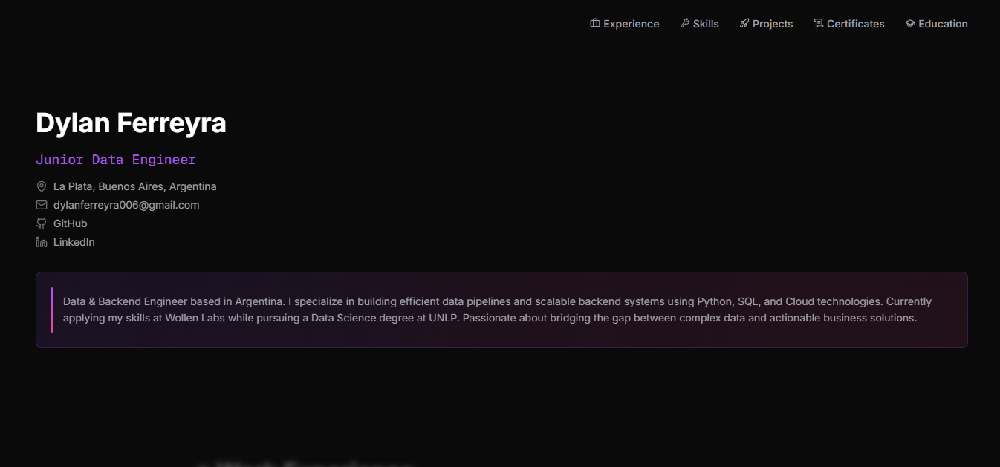

<h1 align="center">Hi there 👋, I'm Dylan Ferreyra</h1>
<h3 align="center">Data Engineer</h3>

  <b>Passionate about bridging the gap between complex data and actionable business solutions.</b>

  I specialize in building robust data pipelines, interactive dashboards, and intelligent applications. My work focuses on automation, scalability, and creating seamless user experiences through technology.

### 🔗 Connect with me:

  
  
  

---

### Take a look at my portfolio!

  
   
  

---
<h3 align="left">💼 Work Experience</h3>

**Data & Backend Engineer | Wollen Labs** *(Nov 2025 - Present)*
- Architected a high-frequency background job engine to manage complex priority logic.
- Led a core database refactoring initiative to a scalable domain-driven architecture.
- Developed a centralized multi-channel notification system (Resend, Twilio, WebSockets).
- Standardized the API layer using tRPC and Zod for end-to-end type safety.

**Software Developer Intern | UNITEC - Edetec - LabTec at UNLP** *(Apr 2025 - Nov 2025)*
- Developed interactive 3D simulation logic in Unity for a home automation system (Casa Adaptada).
- Built an Augmented Reality application using Unity and Vuforia SDK.
- Collaborated on embedded systems development with Arduino (I2C, PWM, EEPROM).

 

<h3 align="left">⛏️ Open Source: Minecraft in Rust</h3>

<table>
  <tr>
    <td width="130" align="center" valign="top">
       
      <b>nalyd006</b>
    </td>
    <td valign="top">
      Contributing to <a href="https://github.com/horizon-rust/horizon"><b>Horizon</b></a>, Minecraft: Java Edition 26.3 rewritten in Rust.
      <ul>
      <li> <b>Fixed splitscreen dropping players:</b> a 96 MiB queue limit was cutting them off as they joined (<a href="https://github.com/horizon-rust/horizon/pull/14319">#14319</a>, commit <a href="https://github.com/horizon-rust/horizon/pull/14319/commits/3750bd11b1dbf6f95e229d273d47994534a1a5af"><code>3750bd1</code></a>)</li>
      <li> <b>Moved the command tree out of <code>play.rs</code>:</b> down to 2,414 lines, from 4,173 originally (<a href="https://github.com/horizon-rust/horizon/pull/13859">#13859</a>, commit <a href="https://github.com/horizon-rust/horizon/commit/791468c6604042b923c0ee4ac3a257db45c6cd99"><code>791468c</code></a>)</li>
      <li> <b>Moved 1,442 lines of tests out of <code>play.rs</code></b>, with every test still passing (<a href="https://github.com/horizon-rust/horizon/pull/13079">#13079</a>, commit <a href="https://github.com/horizon-rust/horizon/commit/ba998968f60714c7e9882f0d89d0eaca64e5c82d"><code>ba99896</code></a>)</li>
      </ul>
      <a href="https://github.com/horizon-rust/horizon/pulls?q=is%3Apr+author%3ADylanGonzaloFerreyra">See all my pull requests →</a>
    </td>
  </tr>
</table>

 

<h3 align="left">🛠️ Skills & Technologies</h3>

**Programming & Backend:** 

**Databases & Cloud:** 

**Data & Tools:** 

 

<h3 align="left">🎓 Education & Certifications</h3>

- **Data Scientist** - Facultad de Informática | Cs. Económicas (UNLP) *(2026 - Present)*
- **High School Diploma in Electronics** - San Vicente de Paul Technical School
- **Certifications:** CS50's Python & SQL, IBM's Big Data Certificate.

 

---

### 📁 Featured Projects

- **Siamerse:** A Full-stack mobile app integrated with AI (Gemini) using React Native and PostgreSQL.
- **Meteorology Data Ecosystem:** Multiple pipelines (SnowPypeLine, Weather Flow) using **Airflow**, **Snowflake**, and **Spark** for automated weather data management.
- **Fictional Store Dashboard:** End-to-end data analysis using Python for data generation and Power BI for interactive insights.
- **Adapted House 3D Simulator:** An interactive smart home simulation built in **Unity** for accessibility research.
- **Augmented Reality Educational App:** Mobile AR application for 3D model rendering via image targets.
